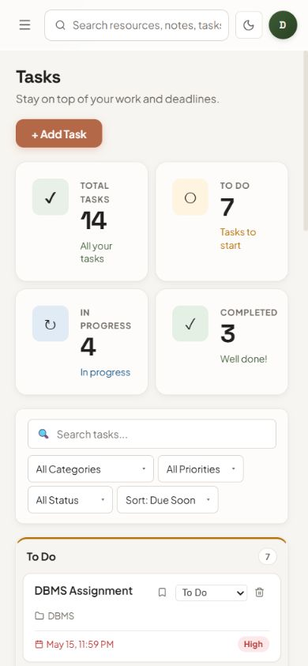

# Anchor audit and fixes — 18 November 2026

The code in `D:\Anchor` was audited against the linked deployment and verified locally against the configured live Firebase, Supabase, and Gemini services. The owner authorized publishing the verified changes to GitHub and the connected Vercel production project on 18 November 2026.

## Verification results

| Check | Result |
| --- | --- |
| Lint with warnings treated as errors | Passed |
| Unit/regression suite | 132 tests passed across 14 files |
| Production build | Passed without the previous oversized-chunk warning |
| Lockfile install simulation | `npm ci --dry-run --ignore-scripts --no-audit` passed |
| Production dependency audit | 0 vulnerabilities |
| Client bundle private-key scan | No Gemini key, Supabase service-role key, or Firebase private key found |
| Git whitespace/diff check | Passed |
| Desktop/mobile browser checks | Passed; mobile viewport 390 px had no horizontal document overflow |
| Full live integration run | Passed; temporary account, known documents, and uploaded PDF cleaned up |

The live integration run verified Firebase authentication; Firestore create/read/update and scoped queries; AI note analysis; task persistence; signed private upload/download; cross-user storage denial; analysis of actual PDF bytes; public URL fetching and analysis; grounded knowledge answers with validated citations; and authenticated file deletion.

The test run used synthetic content and a unique temporary UID. Existing user content was not read, changed, or deleted.

Coverage: 48.95% statements and 52.05% lines, including frontend, API, and shared server code. This is measured coverage, not a claim of exhaustive testing.

The main JavaScript bundle decreased from 766.20 kB / 230.32 kB gzip to 428.95 kB / 132.11 kB gzip: approximately 44% smaller before compression and 43% smaller after compression. Firestore Lite matches the online CRUD/transaction features used by the app. No new Lighthouse scores are claimed.

## Resolved issues

| Area | Issue and fix |
| --- | --- |
| Authentication | Corrupt or blocked local storage could break startup. Storage access now has safe defaults, and a cached real account is not trusted as authentication. |
| Account switching | Late resource/task requests could overwrite a different account's state. Reads are cancelled/ignored after a session change, and async mutations guard their owning session. |
| Missing configuration | Eager Firebase, Supabase, and Gemini initialization could blank the frontend or crash API imports. Initialization and configuration failures are handled at the appropriate boundary; demo mode remains usable. |
| Sign-in | Login incorrectly imposed the new signup password policy on existing users. Login now lets Firebase validate existing passwords. Email input is trimmed. |
| Password reset and profile | The reset link previously did nothing. It now validates the email and sends a reset request. Signup updates the displayed profile name after saving it. |
| Failed writes | Task/resource saves could close forms or appear successful despite failure. Forms preserve input, duplicate submissions are blocked while saving, and committed state changes are shown only after persistence succeeds. |
| Task creation | Column-level Add Task always created a To Do task. It now respects the selected column and records completion metadata. |
| AI tasks | Duplicate prevention depended on stale in-memory state. Deterministic IDs plus Firestore transactions make repeated analysis idempotent across retries/tabs. Missing years are preserved without invented calendar dates. |
| Statistics | Count animations ran only once, leaving totals stale after additions/deletions. They now react to changed values. Completion activity uses completion metadata rather than unrelated bookmark edits. |
| Knowledge retrieval | Raw note content and generic deadline/pending-task questions were missed. Retrieval now includes content, task intent, and date/status filtering, while handling malformed legacy arrays. |
| Navigation/search | Dashboard resource titles did not open resources; global searches dropped their query on navigation; task-only results opened Library. These paths now retain the intended destination/query. |
| Bookmarks | The bookmark page displayed delete controls without passing the delete handler. The action is now wired. Legacy missing categories/tags no longer crash bookmark filtering. |
| Resource analysis | URL re-analysis only analyzed metadata. It now fetches the page content. Private preview errors are visible and retryable; downloads request an attachment-style signed URL. |
| AI endpoint access | Text, URL, and knowledge endpoints could be called without authentication, including invalid-token demo fallbacks. All seven API endpoints now require verified Firebase authentication. Demo search is explicitly local. |
| Provider reliability | Nested provider response schemas caused reproducible generation timeouts. Gemini JSON mode is followed by server-side field validation. A configurable Flash Lite fallback handles primary-model quota/unavailability responses within a bounded request budget. |
| AI output | Null/invalid JSON, malformed nested fields, and fabricated source titles/IDs were not consistently handled. Responses are validated, citations use canonical supplied records, and answers without valid supporting sources are marked not found. |
| Storage | Ambiguous/traversal paths, MIME/extension mismatch, unsupported files, and size inconsistencies are rejected. Upload progress is optional, async Promise executors were removed, and uploads have timeout/abort handling. |
| URL ingestion | Redirects, DNS-resolved private addresses, IPv6/encoded loopback forms, and streamed body size were insufficiently checked. Every connection is validated and pinned to a public address; redirects and response bytes are bounded. Local DNS failures have a validated public DNS fallback. |
| Local API/deployment | Arbitrary path-to-module imports, unlimited JSON bodies, HTML responses for unknown APIs, and short deployment timeouts were corrected. Shared helpers were moved outside `api/`, and Vercel API responses are not cached. |
| Responsive/accessibility | Mobile search filters expanded to 160–180 px because their desktop flex basis became a height. Library, Tasks, and Bookmarks filters now use a compact mobile height. Navigation supports an accessible close action, Escape/focus management, and hidden mobile items are inert. Missing theme-variable aliases were added. |
| Recovery and maintenance | A render error boundary, regression tests, opt-in integration script, CI checks, and accurate setup/deployment documentation were added. Historical test/coverage/Lighthouse claims and broken screenshot references were replaced. |

## Live Supabase configuration

The Supabase project was initially paused/unresolvable. The owner resumed it during the audit. Its existing `anchor-resources` bucket was verified as private, its MIME allowlist was retained, and its maximum size for new uploads was aligned to 20 MB (`20971520` bytes). Existing files were preserved.

## Dependencies and external limits

Production vulnerabilities were resolved through compatible updates, Firebase Admin 14.5.1, the patched gRPC override, and a runtime-compatible Firebase Admin database helper pin. The obsolete Gemini SDK transport was replaced by bounded REST requests.

The full development dependency audit still lists seven transitive findings associated with the same picomatch advisory. GitHub marks [GHSA-fc5q-39xc-vjpf](https://github.com/advisories/GHSA-fc5q-39xc-vjpf) as withdrawn on 18 November 2026. There was no patched version listed at audit time; no forced toolchain downgrade or audit suppression was applied. These packages are development dependencies, and the production-only audit passes.

Gemini quotas, provider outages, protected/JavaScript-rendered URLs, and the contents of individual documents remain external constraints. They now produce controlled errors or use the configured model fallback. The integration test verifies a small synthetic PDF; it is not a load test of every supported file size.

## Release status

Production verification exposed `ERR_REQUIRE_ESM` during API startup: Firebase Admin's CommonJS `jwks-rsa` dependency requires the ESM-only `jose` package. This was reproduced locally by disabling Node's require-ESM support. Vercel disables that feature by default, so the documented `NODE_OPTIONS=--experimental-require-module` runtime setting is now tracked in `vercel.json`. CI checks real API imports after pruning development dependencies with the same runtime setting.

The full integration workflow passed against `https://anchor-lime-two.vercel.app/` after that fix. An initial Gemini 503 during URL analysis was reported as a controlled error; a subsequent verification run passed all stages and cleaned up its synthetic account, documents, and file. A final browser check also found that the global search footer discarded the query and always opened Library; it now shares the Enter-key handler, with application-level tests for resource and task searches.

The release targets the repository main branch and its connected Vercel production app. A release is complete only after confirming the Vercel deployment and a production verification run. Firebase rules changes also require a separate Firebase rules deployment if the legacy Storage rules are used.

Run `npm run dev` or use the currently running [production preview](http://localhost:5190/). For another live integration check, start the app and set `ANCHOR_TEST_URL` to its URL before running `npm run test:integration`.

## Browser evidence

The mobile task view after correcting filter height and verifying navigation, creation, and status changes:

