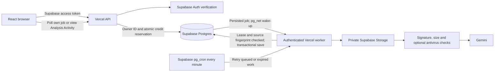

# Production hardening — 19 November 2026

Anchor uses Supabase for Auth, Postgres and private Storage. Vercel serves React and authenticated server APIs. Gemini is called from the server. Firebase is absent from the application's runtime; ignored migration backups and the historical password-import utility are retained for recovery.

## Request and worker design



The database triggers a worker request after the enqueue transaction commits. A minute cron provides recovery if the wake-up request fails. Empty queues do not invoke Vercel. Workers claim one job with `FOR UPDATE SKIP LOCKED`, a random lease and a three-minute expiry. At most three attempts run. Stale leases cannot save results. Source fingerprints prevent an older analysis from overwriting changed source material. AI fields and deterministic generated task IDs are committed together. A browser timeout does not cancel persisted work.

An idempotency key makes enqueue retries safe. A user can have at most three active jobs. The database reserves 100 credits per user per UTC day, with at most 10 accepted requests per minute. Text/questions cost 1 credit, URLs 2, files 4; one accepted job includes its bounded retries. Failures do not refund credits. Reservations serialize per user, so concurrent calls cannot bypass limits. Privileged RPCs are unavailable to anonymous and authenticated browser roles.

## Knowledge provenance and pagination

Q&A retrieves indexed full-text matches from the verified user's database records. Browser context is validated for compatibility and discarded. Server records provide titles, content and file paths. Model citations must match these retrieved records. Lexical search can miss synonyms; retrieval is bounded to eight resources and eight tasks. It is not a vector search implementation.

Resource/task APIs use `(created_at, id)` cursor pagination with ownership checks and a maximum page size of 100. The frontend collects batches of 50 for global views; identical timestamps cannot skip or repeat rows. Verified with 1,005 resources. Library card visibility remains local pagination over that snapshot. Fully lazy global views would require server-side aggregate counts, filters and search rather than treating a partial snapshot as complete.

## File handling and cleanup

Upload paths include the authenticated owner's ID and a random object ID. An intent records expected MIME, byte size and resource ID before a signed upload URL is issued. Before signing a download or supplying an attachment to AI, the server checks actual bytes, size and MIME. It rejects unsupported signatures, unreasonable PNG dimensions and common active/encrypted PDF constructs. Inspections record a SHA-256 digest and clean/rejected state. These checks do not parse every document feature or guarantee absence of malware.

`CLAMAV_HOST`, `CLAMAV_PORT` and optional `CLAMAV_TLS` configure a private INSTREAM scanner. TLS certificate verification is enabled when TLS is used. A configured scanner's timeout, malformed response or connection failure blocks access. No private scanner is configured in this deployment; do not describe built-in checks as full antivirus scanning. Do not point this service at a public scanner without reviewing file disclosure and access controls.

Hourly cleanup claims at most five tracked uploads older than 48 hours with no resource reference. The reference trigger and intent locks reject saves while cleanup owns an object. Failed deletions remain retryable. Referenced files, new uploads, untracked legacy files and historical migration backups are not swept. Seven-day job history and 30-day usage/deleted-intent history are pruned; saved resources and tasks remain.

## Deployment and monitoring

Apply migrations in order. The production database already has these migrations; do not manually reapply them. Enable Fluid Compute for the Vercel project's function durations. The app has 11 API endpoints. Keep server secrets out of `VITE_` variables and source control.

After worker endpoints have been deployed and tested:

```bash
node scripts/configure-worker.mjs https://anchor-lime-two.vercel.app
npm run check:health
node scripts/check-api-startup.mjs --live https://anchor-lime-two.vercel.app
```

The setup script stores a generated worker credential in ignored `.env.local` and the private database configuration, never in the public frontend or cron SQL text. Rotating it requires updating the private value and rerunning the setup script. The worker bearer token is administrative; do not share it.

`check:health` reports queued/processing/stalled jobs and recent failures using server credentials. It exits unsuccessfully if the worker is unconfigured or jobs are stalled. Public GitHub Actions checks run every six hours and on manual dispatch; they verify the homepage and each API's JSON authentication rejection. These checks detect startup and routing failures; they do not replace authenticated workflow testing. GitHub's schedules are best effort, and notification delivery follows the owner's GitHub settings. No external alert recipient has been configured.

Vercel structured worker logs contain kind, provider outcome, attempt, save acknowledgement and elapsed time, without user text, file paths or tokens. Supabase Cron's job history shows dispatch failures. Analysis Activity is owner-scoped and shows seven days of request status; completed results reload from the database.

## Verification

```bash
npm run lint
npm test
npm run build
npm run check:api
npm audit --omit=dev --audit-level=moderate
```

The suite includes forged context, private paths, quota failures, local antivirus protocol responses, durable completion, stale leases, retries and Activity UI tests. `npm run test:integration` uses real Auth/Database/Storage/Gemini with disposable users and removes them. Recovery is tested with generated tokens, without sending email.

`npm run test:hardening` creates disposable accounts and verifies 1,005-row cursors, cross-account RPC denial, server retrieval, concurrent limits, idempotent enqueue and transactional completion. It writes a rollback-only SQL verification to ignored `.work.local/verify-hardening.sql` for administrative testing of daily limits, cleanup and queue claims. After that check, run `node scripts/hardening-integration.mjs --cleanup`. Never leave fixture accounts behind. These checks consume actual service resources; run explicitly.

## Hosted features awaiting owner configuration

* **Email delivery:** the owner chose to obtain a custom domain later. Supabase default email remains configured; it is restricted and is not reliable public production email. Configure a verified sending domain and custom SMTP before relying on confirmation/reset delivery. [Supabase SMTP documentation](https://supabase.com/docs/guides/auth/auth-smtp).
* **Leaked passwords:** Supabase's advisor still reports leaked-password protection disabled. This hosted feature requires a supported plan (currently Pro and above); no plan upgrade was authorized. Enable it in Auth when eligible. [Password protection requirements](https://supabase.com/docs/guides/auth/password-security#password-strength-and-leaked-password-protection).
* **Antivirus:** configure a reachable private ClamAV service for full engine scanning. Signature checks remain active meanwhile.

No purchase, plan upgrade or new third-party file-sharing service was provisioned. Existing real-user content and historical backups were preserved.
